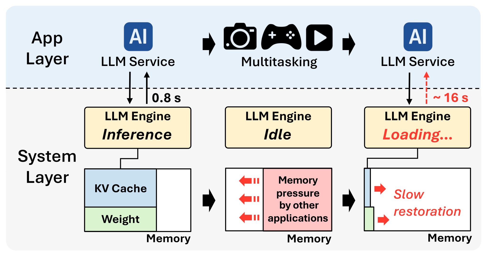

# mzCache: On-Device LLM Memory Management under Multitasking

**ACM MobiCom 2026** · [Full paper](https://doi.org/10.1145/3795866.3844495) ·
[Demo paper](https://doi.org/10.1145/3795866.3848469)

<p align="center">
  
</p>
<p align="center"><em>Figure 1: Multitasking on mobile devices. Memory pressure from
concurrent apps evicts LLM memory, increasing the response time from 0.8 s to
16 s.</em></p>

With a long context, the weights and KV cache of even a small on-device LLM can
take 5–7 GB, nearly half of a 12 GB phone. When other apps need that memory, the
OS evicts it or kills the LLM process outright, and the next request waits on
slow storage reads or a full recompute.

mzCache manages the memory of an on-device LLM while the user switches between
apps. When memory runs low, it evicts the KV cache in compressed chunks and
unloads weight layers. On the next request, it restores them while the GPU runs
prefill, which gives 2.1–5.5× lower time-to-first-token than a storage-backed
partial-offload baseline.

This repository is the artifact for the paper. It contains the mzCache engine
(a fork of [llama.cpp](https://github.com/ggml-org/llama.cpp) at `fa4a9f2a`),
the two baselines, and the scripts that reproduce the paper's main figures.

## Demo video

The mzCache app and the OS-paging baseline run the same app-switching workload
(30× speed). mzCache frees memory each time it goes to the background and
responds quickly when it comes back. The baseline is killed by Android's
low-memory killer and has to reload from scratch.

https://github.com/user-attachments/assets/3925f5db-1e82-4838-b98f-e9cf8accd564

## Start here

See [EVALUATION.md](EVALUATION.md) for hardware requirements, setup, and
step-by-step instructions for each experiment.

## License

MIT, following llama.cpp. Vendored Khronos OpenCL headers under
`examples/llama.android/.../CL/` are Apache-2.0.

## Citation

If you use mzCache in your research, please cite our paper:

```bibtex
@inproceedings{yu2026mzcache,
  title     = {mzCache: On-Device LLM Memory Management under Multitasking},
  author    = {Yu, Hongseung and Kim, Minsung and Park, Jongseok and Lee, Kyunghan},
  booktitle = {Proceedings of the 32nd Annual International Conference on
               Mobile Computing and Networking (MobiCom '26)},
  year      = {2026}
}
```
